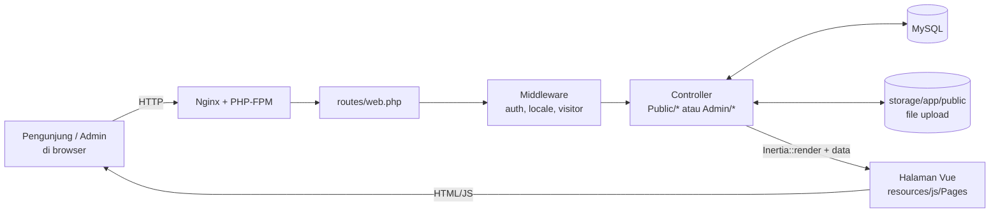
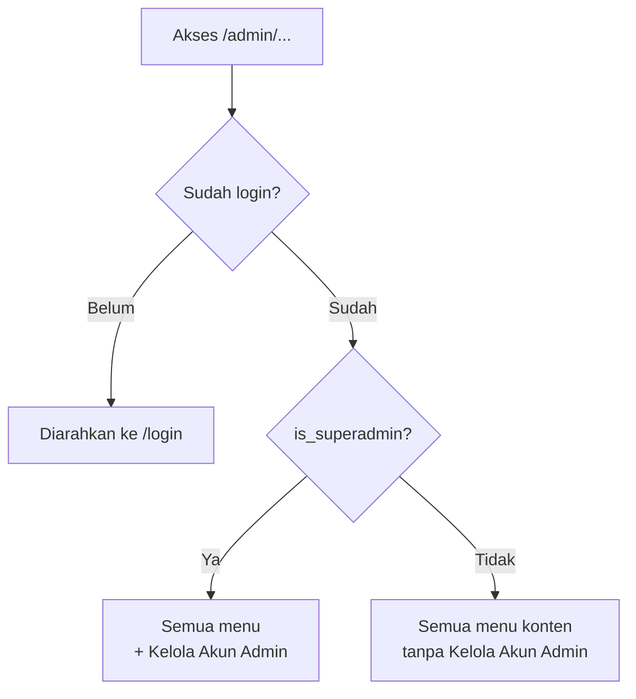

# 01 – Alur Sistem

## Gambaran besar

Website ini adalah **satu aplikasi Laravel** (monolit). Laravel mengurus data dan logika, Vue mengurus tampilan, dan **Inertia.js** menjadi jembatan di antaranya. Tidak ada API terpisah: controller Laravel langsung mengirim data ke halaman Vue.

## Dua sisi aplikasi

| | Halaman publik | Panel admin |
|---|---|---|
| URL | `/`, `/berita`, `/prestasi`, `/mitra-kp-magang`, … | semua di bawah `/admin/...` |
| Siapa | Siapa saja, tanpa login | Hanya akun admin yang sudah login |
| Controller | `app/Http/Controllers/Public/` | `app/Http/Controllers/Admin/` |
| Halaman Vue | `resources/js/Pages/Public/` | `resources/js/Pages/Admin/` |
| Layout | `PublicLayout.vue` (navbar + footer) | `AdminLayout.vue` (sidebar) |

**Pola dasarnya:** admin mengisi data di panel admin → data tersimpan di MySQL (dan file di storage) → halaman publik membaca data yang sama dan menampilkannya. Hampir semua modul mengikuti pola ini.

## Alur sebuah permintaan

**Contoh 1: pengunjung membuka `/mitra-kp-magang?prodi=6`**

1. Route di `routes/web.php` mengarahkan ke `PublicInternshipPartnerController@index`.
2. Middleware `TrackVisitor` mencatat kunjungan (bot dan admin yang login tidak dihitung).
3. Controller mengambil mitra yang **aktif** dari tabel `internship_partners`, lalu memfilter prodi dengan id 6.
4. Controller memanggil `Inertia::render('Public/InternshipPartners/Index', [...data])`.
5. Vue merender halaman. Saat filter diganti, Inertia meminta ulang ke server tanpa reload penuh.

**Contoh 2: admin menambah mitra baru**

1. Admin membuka `/admin/mitra-kp-magang/create`. Middleware `auth` + `verified` menolak kalau belum login.
2. Form dikirim (POST) ke `InternshipPartnerController@store`.
3. Controller **memvalidasi** input. Kalau ada yang salah, form kembali dengan pesan error per kolom.
4. Logo disimpan ke `storage/app/public/internship_partners/`, lalu datanya disimpan ke database.
5. Admin diarahkan ke halaman daftar dengan notifikasi sukses (flash message).

## Login & hak akses

- Ada **dua peran**, ditandai kolom `is_superadmin` di tabel `users`:
  - **Super Admin:** semua menu + **Kelola Akun Admin** (melihat, menambah, mengedit, menghapus akun admin lain).
  - **Admin:** semua menu konten. Kalau membuka `/admin/users` langsung, mendapat 403.
- **Registrasi publik dimatikan** (`routes/auth.php`). Akun admin baru hanya dibuat oleh Super Admin.
- Akun Super Admin tidak bisa dihapus lewat panel, dan admin tidak bisa menghapus akunnya sendiri.

## Data yang dipakai di semua halaman

`app/Http/Middleware/HandleInertiaRequests.php` mengirim data berikut ke setiap halaman:

| Data | Dipakai untuk |
|---|---|
| `auth.user` | Info akun yang login (sidebar admin, cek superadmin) |
| `flash.success` / `flash.error` | Notifikasi setelah simpan/hapus |
| `globalProdi` | Daftar prodi di menu navbar **Program Studi** |
| `contact_global` | Alamat & kontak di footer (diisi di **Kelola Kontak**) |
| `faculty_settings` | Pengaturan dari **Kelola Tentang Fakultas** |
| `visitorStats` | Statistik pengunjung di footer |
| `locale` | Bahasa aktif (Indonesia/Inggris) |

> Artinya: kalau footer atau menu prodi tampil salah, sumber datanya ada di menu admin **Kelola Kontak**, **Kelola Tentang Fakultas**, atau **Kelola Program Studi**, bukan di kode.

## Penyimpanan file

- File yang di-upload admin (logo, foto, PDF) disimpan di `storage/app/public/<nama-modul>/` dan diakses publik lewat `/storage/...` (symlink dari `php artisan storage:link`).
- Gambar bawaan yang statis ada di `public/images/`.
- **Folder `storage/app/public` tidak ada di git.** Folder ini harus ikut dibackup bersama database.

## Peta modul → tabel

| Modul | Tabel utama |
|---|---|
| Akun admin | `users` |
| Tentang Fakultas, Kontak | `faculty_profiles`, `contacts` |
| Dosen & Tendik | `staff` |
| Program Studi, Jurusan | `study_programs`, `departments` |
| Berita & kategori | `posts`, `post_categories` |
| Pengumuman, Agenda | `announcements`, `agendas` |
| Prestasi | `achievements` |
| Kegiatan Mahasiswa, Beasiswa | `student_activities`, `scholarships` |
| **Mitra KP/Magang** | `internship_partners` |
| Kerjasama | `partners` |
| Alumni & testimoni | `alumnis`, `alumni_testimonials` |
| PPID | `ppid_documents`, `ppid_categories` |
| Zona Integritas | `zi_profiles`, `zi_documents` |
| Survei Kepuasan | `satisfaction_surveys`, `survey_categories` |
| Layanan Internal | `internal_services` |
| Penelitian, Pengabdian | `research`, `community_services` |
| Statistik pengunjung | `visitors` |
| Sistem Laravel | `sessions`, `cache`, `jobs`, `password_reset_tokens` |

Nama tabel pastinya bisa dicek di `database/migrations/`.
